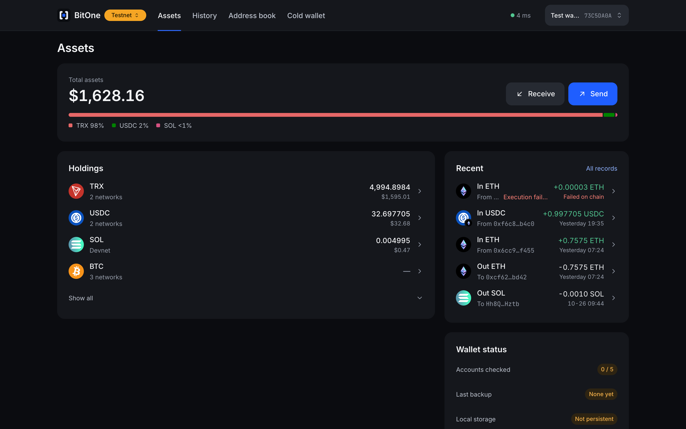
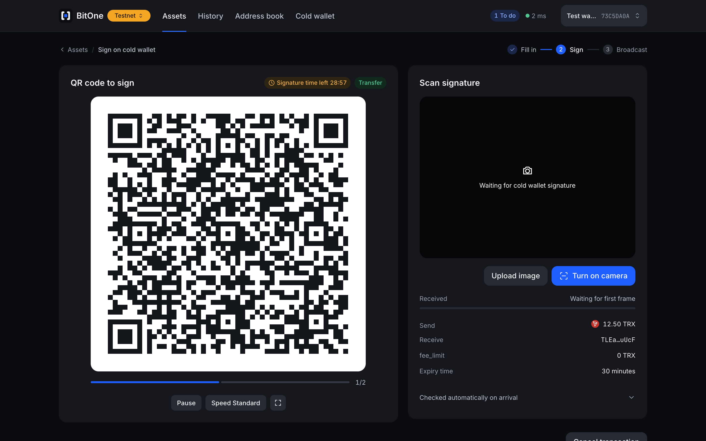
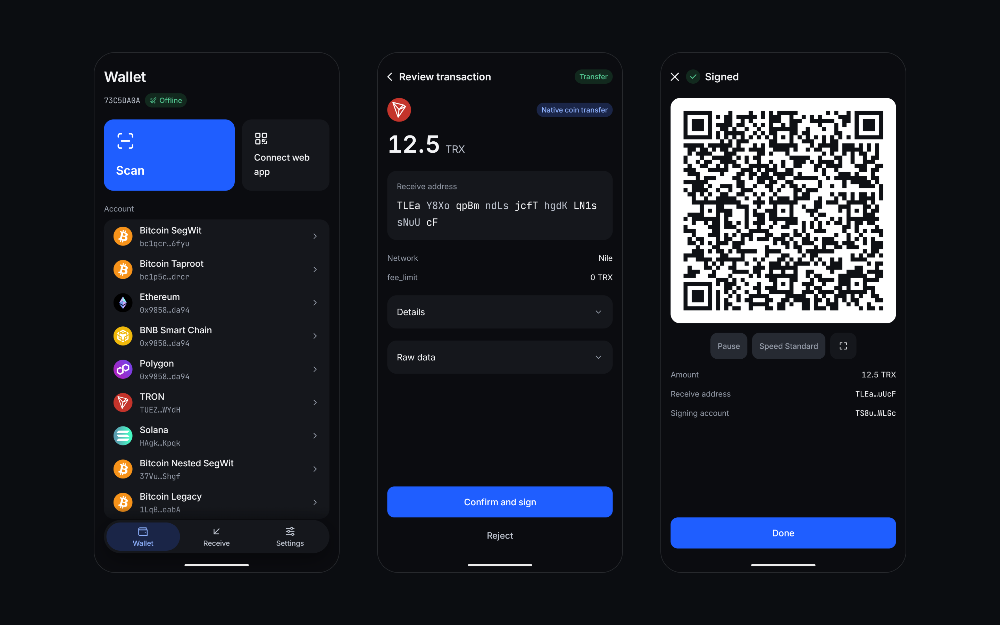

<p align="center">
  
</p>

<h1 align="center">BitOne</h1>

<p align="center">
  <b>Between the two ends, only one bit.</b><br>
  A multi-chain wallet whose private keys never go online
</p>

<p align="center">
  
  
  
  
  
</p>

<p align="center">
  <a href="#architecture">Architecture</a>　
  <a href="#features">Features</a>　
  <a href="#security">Security</a>　
  <a href="#data-sources">Data Sources</a>　
  <a href="#usage">Usage</a>　
  <a href="#development">Development</a>　
  <a href="#license">License</a>　
  <a href="docs/README.md">Docs</a>
</p>

<p align="center">
  <b>English</b>　<a href="README.zh-CN.md">简体中文</a>
</p>

---

BitOne is a multi-chain cold wallet. Private keys stay on an offline Android phone, the web app builds transactions in your browser, and QR codes are the only link between them. It is a public-good project. There is no account, and no server keeps your wallet data.

|                                  **Web App**                                   |                                **Ready to Sign**                                 |                                   **Cold Wallet**                                    |
| :----------------------------------------------------------------------------: | :------------------------------------------------------------------------------: | :----------------------------------------------------------------------------------: |
| [](docs/screenshots/web-assets.png) | [](docs/screenshots/web-sign.png) | [](docs/screenshots/cold-wallet.png) |

<p align="center"><sub>Screenshots show the real apps on testnet.</sub></p>

## Architecture

Only the cold wallet holds private keys. The web app and gateway are designed as if already compromised.

- **Cold wallet (`apps/mobile`)**: Android app. Holds the keys, reviews and signs.
- **Web app (`apps/web`)**: Builds transactions and manages watch-only wallets. Holds public keys only and keeps its data in the browser.
- **Gateway (`crates/bitone-gateway`)**: Serves queries, WebSocket subscriptions and broadcast relay. Stores no user data and has no login.
- **Signer (`crates/bitone-signer`)**: Mnemonics, derivation and signing. Compiled into the cold wallet only, so the web build contains no signing code.

## Features

- **Air gap**: BC-UR animated QR codes are the only channel. Large transactions loop across frames.
- **Multi-chain**: Bitcoin, Ethereum, BNB Smart Chain, Polygon, TRON, Solana and their testnets.
- **Independent review**: The cold wallet parses each transaction and rates its risk itself. It ignores what the web app claims.
- **Two-layer encryption**: The seed is encrypted with a PIN-derived key, then with a hardware Keystore key.
- **Offline self-check**: Airplane mode, root, debugging and screen lock are checked at launch and before signing. A failed check locks signing.
- **Built-in list**: Token data ships with the app and updates offline by QR, taking effect only after its signature checks out.

Not supported: iOS, HarmonyOS NEXT, DApp connections, message signing, swaps, multisig and NFTs.

## Security

Before signing, the cold wallet parses every field from the raw transaction and re-derives addresses from their paths. If the web app or gateway is compromised, the tampering shows on the cold wallet screen, so read that screen every time.

### What It Does Not Protect Against

- **Everyday phones**: The air gap depends on a dedicated phone: factory reset, no accounts signed in, BitOne only.
- **Fake balances**: A malicious gateway can fake balances, deposits and confirmations, and the cold wallet cannot check them. Confirm large deposits from another source.
- **Address linking**: The gateway and node providers see the addresses you query and can link them. If that matters, self-host with your own nodes.
- **Lost recovery phrase**: There is no account and nobody can recover it for you. If you lose the phone or forget the PIN, the recovery phrase is the only way back.
- **Signing without reading**: Long-press and banners only lower the odds.

The full threat model is in [docs/04-security.md](docs/04-security.md) (Chinese). Verification status and known limits are in [docs/07-verification.md](docs/07-verification.md) (Chinese).

### Verify It Yourself

```bash
# Run all tests and checks
make test

# Confirm the APK has no INTERNET permission
make dist-android
apkanalyzer manifest permissions dist/bitone-v0.1.0-android-unsigned.apk
```

The build also fails if the merged manifest gains a network permission. Two clean builds on one machine produce the same unsigned APK hash. Builds across machines and in containers have not been verified.

## Data Sources

The cold wallet never goes online and uses none of these. The web app talks only to the gateway, and the gateway reads chain data from the services below. They are the free public defaults in [`gateway.example.toml`](crates/bitone-gateway/gateway.example.toml), which also lists the testnets.

| Data                             | Source                                             |
| :------------------------------- | :------------------------------------------------- |
| Bitcoin                          | Blockstream, ACINQ, fulcrum.grey.pw, mempool.space |
| Ethereum                         | PublicNode, dRPC                                   |
| BNB Smart Chain, Polygon         | PublicNode                                         |
| TRON                             | TronGrid (API key recommended)                     |
| Solana                           | Solana public RPC                                  |
| Ethereum history                 | Routescan                                          |
| BNB Smart Chain, Polygon history | HyperSync (token required)                         |
| USD prices                       | CoinGecko                                          |

Bitcoin, TRON and Solana history come from the same sources. EVM nodes cannot look up an address's history, so those chains need a separate service.

- **Prices**: For display only. They play no part in any check.
- **Token data**: Names and contracts come from the built-in list, not from these services.
- **Explorer links**: Transaction links open a public block explorer such as mempool.space or Etherscan. The web app reads no data from them.

Limits of the defaults:

- **BNB Smart Chain, Polygon**: No history service works without a key. Without a HyperSync token, history covers only transactions seen during a subscription and those sent from this browser.
- **Solana**: The public RPC throttles hard, so history for busy addresses can fail to load.
- **TRON**: Without an API key, TronGrid allows 3 requests per second and suspends queries for 4 seconds when that is exceeded.
- **Bitcoin**: Electrum comes first, with Esplora as backup. Public Electrum servers are run by volunteers, with no uptime guarantee.

All of these services can see the addresses you query, see [What It Does Not Protect Against](#what-it-does-not-protect-against). To change a source, edit the config. Each network uses its sources in order and moves to the next on failure. For Bitcoin, put your own electrs or Fulcrum first.

## Usage

The cold wallet works the same way in all three. They differ in who runs the gateway and who builds the software.

| Option            | Web App and Gateway          | Cold Wallet        |
| :---------------- | :--------------------------- | :----------------- |
| Official          | bitone.cloudtay.com          | Official APK       |
| Private gateway   | Your server, release package | Official APK       |
| Build from source | Your build                   | Your build and key |

### 1. Official

Use a dedicated phone, see [What It Does Not Protect Against](#what-it-does-not-protect-against). Connect it by USB with USB debugging on. `apksigner` and `adb` are in the Android SDK `build-tools` and `platform-tools`.

Set `VERSION` to the latest of [Releases](https://github.com/ccobcode/bitone/releases). The APK installs only if its signing certificate matches.

```bash
VERSION=0.1.0
APK=bitone-v$VERSION-android.apk
CERT=d9f761bbbaf9cf637e579a88c69b04391de49d1853f6a078424f098edbe97c73

curl -fLO https://github.com/ccobcode/bitone/releases/download/v$VERSION/$APK
apksigner verify --print-certs $APK | grep $CERT && adb install $APK
```

On the phone, set a screen lock, turn off USB debugging, turn on airplane mode, then create a wallet. The self-check locks signing if any of these is missing.

Open [bitone.cloudtay.com](https://bitone.cloudtay.com) and pair the cold wallet.

### 2. Private Gateway

The release package holds the gateway and web app, so the web app talks only to your server. It runs on Linux `x86_64` and `aarch64`. Set up the cold wallet as in [Official](#1-official).

```bash
VERSION=0.1.0
curl -fL https://github.com/ccobcode/bitone/releases/download/v$VERSION/bitone-v$VERSION-linux-$(uname -m).tar.gz | tar -xz
cd bitone
{ echo 'web_dir = "web"'; cat gateway.example.toml; } > gateway.toml
./bin/bitone-gateway --config gateway.toml
```

The gateway listens on `127.0.0.1:8787`. Browsers allow the camera only over HTTPS or on localhost, so put a reverse proxy with a certificate in front of it and add the proxy's IP to `trusted_proxies`. The defaults use free public services, see [Data Sources](#data-sources).

### 3. Build from Source

Requires rustup, Node, pnpm, JDK 21, the Android SDK and NDK. The WASM build needs LLVM from Homebrew (`brew install llvm`).

```bash
git clone https://github.com/ccobcode/bitone.git
cd bitone
VERSION=0.1.0
make dist VERSION=$VERSION
```

Outputs go to `dist/`:

- `bitone-v<VERSION>-<os>-<arch>.tar.gz`: Gateway and web app. Deploy it as in [Private Gateway](#2-private-gateway).
- `bitone-v<VERSION>-android-unsigned.apk`: Cold wallet.

Android installs only signed APKs, so generate a signing key once. `keytool` asks for a password.

```bash
KEYSTORE=$HOME/bitone.jks
keytool -genkeypair -keystore $KEYSTORE -alias bitone -keyalg EC -groupname secp256r1 -validity 10000 -dname "CN=BitOne"
```

Sign the APK and install it over USB, then set up the phone as in [Official](#1-official).

```bash
apksigner sign --ks $KEYSTORE --out dist/bitone-v$VERSION-android.apk dist/bitone-v$VERSION-android-unsigned.apk && adb install dist/bitone-v$VERSION-android.apk
```

Keep the keystore, because updates must use the same key. Your build and the official APK cannot update each other.

To run the gateway and web app in a container instead:

```bash
{ printf 'listen = "0.0.0.0:8787"\nweb_dir = "/srv/bitone/web"\n'; grep -v '^listen =' crates/bitone-gateway/gateway.example.toml; } > gateway.toml
docker build -f docker/selfhost.Dockerfile -t bitone .
docker run -p 8787:8787 -v ./gateway.toml:/etc/bitone/gateway.toml bitone
```

## Development

```bash
# Start the gateway and web app, then open http://localhost:5173
make dev

# Run all tests and checks
make test

# Format Rust, web and Kotlin
make format

# Regenerate tokens for both clients after editing design/tokens.json
make tokens

# Install a debug build on a connected phone
make android-core
cd apps/mobile && ./gradlew :androidApp:assembleDebug
adb install -r androidApp/build/outputs/apk/debug/androidApp-debug.apk
```

`make dev` reads `gateway.local.toml` in the repo root, then falls back to the example config. Copy the example to add API keys. The copy stays out of Git.

`make lint` runs clippy and Biome, `make audit` checks dependency vulnerabilities and licenses, and `make hooks` enables the Git hooks. Debug builds are for development and testnet only.

## License

[MIT](LICENSE) © ccobcode
