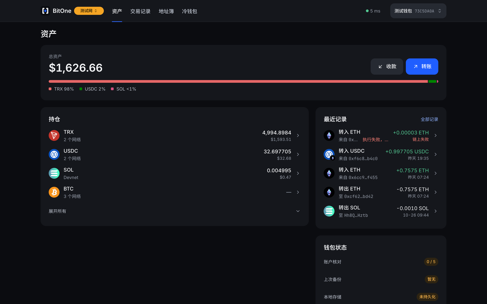
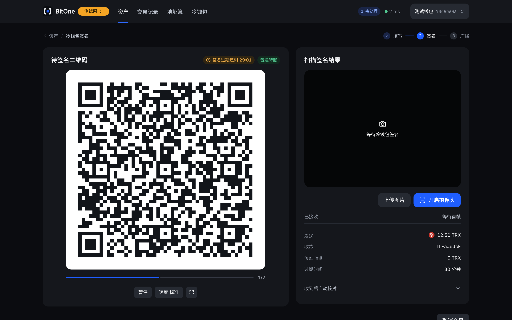
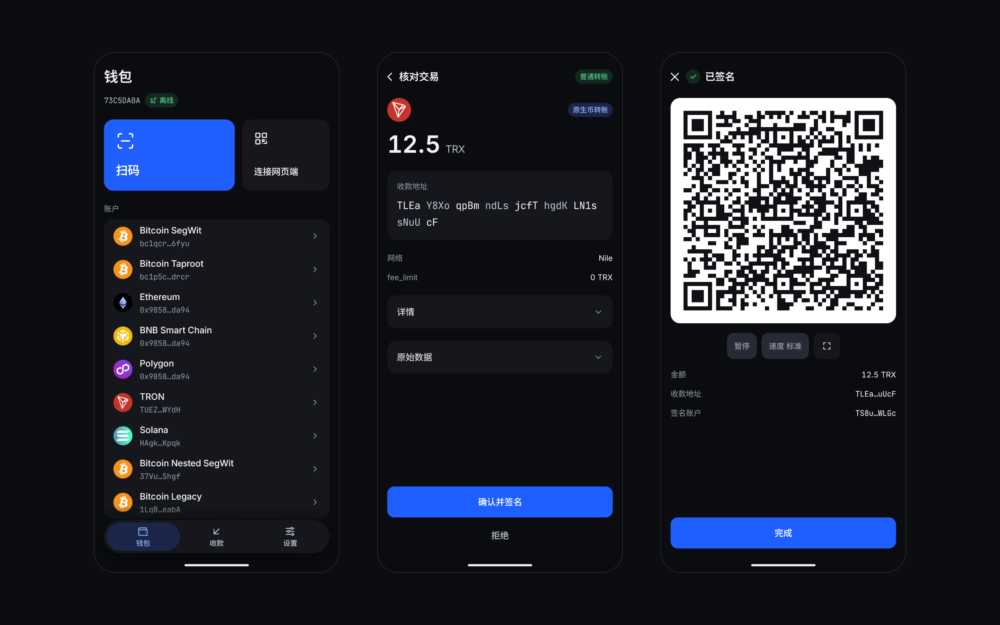

<p align="center">
  
</p>

<h1 align="center">BitOne</h1>

<p align="center">
  <b>两端之间,只有一个比特.</b><br>
  私钥永不联网的多链钱包
</p>

<p align="center">
  
  
  
  
  
</p>

<p align="center">
  <a href="#架构">架构</a>　
  <a href="#功能">功能</a>　
  <a href="#安全">安全</a>　
  <a href="#数据源">数据源</a>　
  <a href="#使用方式">使用方式</a>　
  <a href="#开发">开发</a>　
  <a href="#发布">发布</a>　
  <a href="#许可证">许可证</a>　
  <a href="docs/README.md">文档</a>
</p>

<p align="center">
  <a href="README.md">English</a>　<b>简体中文</b>
</p>

---

BitOne 是一款多链冷钱包.私钥只在一台离线的 Android 手机上,网页端在浏览器里构建交易,两者之间只有二维码.这是一个公益项目,不需要账号,也没有服务端保存你的钱包数据.

|                                        **网页端**                                         |                                      **待签名**                                       |                                         **冷钱包**                                          |
| :---------------------------------------------------------------------------------------: | :-----------------------------------------------------------------------------------: | :-----------------------------------------------------------------------------------------: |
| [](docs/screenshots/web-assets.zh-CN.png) | [](docs/screenshots/web-sign.zh-CN.png) | [](docs/screenshots/cold-wallet.zh-CN.png) |

<p align="center"><sub>例图是测试网上的真实界面.</sub></p>

## 架构

只有冷钱包持有私钥.网页端和网关都按可能已被入侵来设计.

- **冷钱包 (`apps/mobile`)**:Android 应用,保管密钥,核对并签名.
- **网页端 (`apps/web`)**:构建交易,管理观察钱包.只有公钥,数据存在浏览器里.
- **网关 (`crates/bitone-gateway`)**:提供查询,WebSocket 订阅和代理广播.不存用户数据,不鉴权.
- **签名库 (`crates/bitone-signer`)**:助记词,派生和签名.只编进冷钱包,网页端的构建产物里没有签名代码.

## 功能

- **气隙**:两端只通过 BC-UR 动态二维码交换数据,大交易分帧循环播放.
- **多链**:Bitcoin,Ethereum,BNB Smart Chain,Polygon,TRON,Solana 和它们的测试网.
- **独立核对**:冷钱包自己解析交易并判定风险,不采信网页端的说明.
- **两层加密**:种子先用 PIN 派生的密钥加密,再用 Keystore 硬件密钥加密.
- **离线自检**:启动时和签名前都检查飞行模式,Root,调试模式和屏幕锁,不通过就锁定签名.
- **内置清单**:代币信息随应用内置,扫码离线更新,验签后才生效.

不支持 iOS,鸿蒙 NEXT,DApp 连接,消息签名,兑换,多签和 NFT.

## 安全

签名前,冷钱包从原始交易里独立解析所有字段,并从派生路径重新算出地址比对.网页端或网关被入侵时,篡改的内容会显示在冷钱包屏幕上,所以每次都要核对屏幕.

### 防不住的事

- **日常手机**:气隙靠专用手机成立.手机要恢复出厂设置,不登录账号,只安装 BitOne.
- **伪造余额**:恶意网关能伪造余额,入账和确认数,冷钱包无法验证.大额收款请在其他来源核对.
- **地址关联**:网关和节点服务商能看到你查询的地址,也能看出它们可能属于同一个人.介意的话请自己部署,并连接自己的节点.
- **丢失助记词**:没有账号,也没有人能替你找回.手机丢失或忘记 PIN 时,只能用助记词恢复.
- **不看就确认**:长按和横幅只能降低概率.

完整的威胁模型见 [docs/04-security.md](docs/04-security.md),验证状态和已知限制见 [docs/07-verification.md](docs/07-verification.md).

### 自己验证

```bash
# 跑全部测试和检查
make test

# 确认 APK 没有 INTERNET 权限
make dist-android
apkanalyzer manifest permissions dist/bitone-v0.1.0-android-unsigned.apk
```

构建时也会检查合并后的清单,出现联网权限就失败.同一台机器上从干净状态构建两次,未签名 APK 的哈希一致.跨机器和容器内的构建还没有验证.

## 数据源

冷钱包从不联网,不用这些服务.网页端只连网关,网关从下面的服务读取链上数据.这些是 [`gateway.example.toml`](crates/bitone-gateway/gateway.example.toml) 里的免费公共默认值,测试网也列在那里.

| 数据                             | 来源                                            |
| :------------------------------- | :---------------------------------------------- |
| Bitcoin                          | Blockstream,ACINQ,fulcrum.grey.pw,mempool.space |
| Ethereum                         | PublicNode,dRPC                                 |
| BNB Smart Chain,Polygon          | PublicNode                                      |
| TRON                             | TronGrid(建议配 API key)                        |
| Solana                           | Solana 公共 RPC                                 |
| Ethereum 交易历史                | Routescan                                       |
| BNB Smart Chain,Polygon 交易历史 | HyperSync(需要 token)                           |
| 美元价格                         | CoinGecko                                       |

Bitcoin,TRON 和 Solana 的交易历史来自同一批服务.EVM 节点查不了地址的历史,所以要单独的服务.

- **价格**:只用于展示,不参与任何判断.
- **代币信息**:名称和合约来自内置清单,不来自这些服务.
- **浏览器链接**:交易链接打开 mempool.space,Etherscan 这类公共区块浏览器,网页端不从它们读取数据.

默认配置的限制:

- **BNB Smart Chain,Polygon**:没有免 key 的历史服务.没配 HyperSync token 时,只有订阅期间的交易和从本机发出的交易.
- **Solana**:公共 RPC 限流很紧,活跃地址的历史可能加载失败.
- **TRON**:不配 API key 时,TronGrid 限制每秒 3 次请求,超限后暂停 4 秒.
- **Bitcoin**:优先用 Electrum,Esplora 做备用.公共 Electrum 服务器由志愿者运营,不保证可用.

这些服务都能看到你查询的地址,见[防不住的事](#防不住的事).换数据源只改配置:每个网络按顺序使用上游,失败时切换下一个.Bitcoin 把自建的 electrs 或 Fulcrum 写在最前面即可.

## 使用方式

三种方式的冷钱包用法相同,区别在于谁运行网关,谁构建软件.

| 方式     | 网页端和网关           | 冷钱包         |
| :------- | :--------------------- | :------------- |
| 官方版   | bitone.cloudtay.com    | 官方 APK       |
| 私有网关 | 自己的服务器和官方镜像 | 官方 APK       |
| 源码构建 | 自己构建               | 自己构建并签名 |

### 1. 官方版

使用专用手机,要求见[防不住的事](#防不住的事).用数据线连接手机并开启 USB 调试.`apksigner` 和 `adb` 在 Android SDK 的 `build-tools` 和 `platform-tools` 目录里.

把 `VERSION` 改成 [Releases](https://github.com/ccobcode/bitone/releases) 的最新版本.只有签名证书匹配时才会安装 APK.

```bash
VERSION=0.1.0
APK=bitone-v$VERSION-android.apk
CERT=d9f761bbbaf9cf637e579a88c69b04391de49d1853f6a078424f098edbe97c73

curl -fLO https://github.com/ccobcode/bitone/releases/download/v$VERSION/$APK
apksigner verify --print-certs $APK | grep $CERT && adb install $APK
```

在手机上设置屏幕锁,关闭 USB 调试,开启飞行模式,然后创建钱包.缺少任何一项,自检都会锁定签名.

打开 [bitone.cloudtay.com](https://bitone.cloudtay.com),配对冷钱包.

### 2. 私有网关

官方镜像里有网关和网页端,网页端只连接你自己的服务器.冷钱包的设置方法同[官方版](#1-官方版).

网页端的摄像头和交易构建都要求 HTTPS 或 localhost,所以 compose 文件在网关前放了 Caddy 来申请证书.把域名解析到服务器,并开放 80 和 443 端口.

```bash
export VERSION=0.1.0
export DOMAIN=bitone.example.com
curl -fLO https://raw.githubusercontent.com/ccobcode/bitone/v$VERSION/docker/compose.yaml
docker compose up -d
```

如果只想在本机试用,单独运行镜像,打开 `http://localhost:8787`.

```bash
docker run -p 127.0.0.1:8787:8787 ghcr.io/ccobcode/bitone:0.1.0
```

不用 Docker 时,使用发布包,支持 Linux 的 `x86_64` 和 `aarch64`,需要自己配 HTTPS 反向代理.

```bash
VERSION=0.1.0
curl -fL https://github.com/ccobcode/bitone/releases/download/v$VERSION/bitone-v$VERSION-linux-$(uname -m).tar.gz | tar -xz
cd bitone
./bin/bitone-gateway --config gateway.example.toml --web-dir web
```

默认配置使用免费公共服务,见[数据源](#数据源).要填 API key 时,把 `gateway.example.toml` 复制成 `gateway.toml`,用 `--config` 传入,或者按 `compose.yaml` 里的注释挂载.代理的 IP 用 `--trusted-proxy` 添加.

### 3. 源码构建

需要 rustup,Node,pnpm,JDK 21,Android SDK 和 NDK,OpenSSL 和 GnuPG.WASM 构建需要 Homebrew 的 LLVM(`brew install llvm`).`apksigner` 和 `adb` 在 Android SDK 的 `build-tools` 和 `platform-tools` 目录里.

```bash
git clone https://github.com/ccobcode/bitone.git
cd bitone
VERSION=0.1.0
make dist VERSION=$VERSION
```

产物在 `dist/`:

- `bitone-v<VERSION>-<os>-<arch>.tar.gz`:网关和网页端.
- `bitone-v<VERSION>-android-unsigned.apk`:冷钱包.

Android 只能安装已签名的 APK.先生成一次签名密钥,`S` 是存放加密私钥和证书的目录.gpg 会要求设置口令,签发证书时再输入一次.

```bash
S=$HOME/Signing/bitone
mkdir -p "$S/apk/v1"
openssl genpkey -algorithm EC -pkeyopt ec_paramgen_curve:P-256 -outform DER | gpg --symmetric --no-symkey-cache --cipher-algo AES256 --s2k-mode 3 --s2k-digest-algo SHA512 --s2k-count 65011712 -o "$S/key.der.gpg" &&
openssl req -x509 -new -key <(gpg --decrypt --no-symkey-cache --quiet "$S/key.der.gpg") -keyform DER -sha256 -days 10000 -subj "/CN=BitOne" -addext "basicConstraints=critical,CA:FALSE" -addext "keyUsage=critical,digitalSignature" -out "$S/apk/v1/cert.pem"
```

签名 APK 并通过 USB 安装,手机的设置方法同[官方版](#1-官方版).私钥只经过管道,不会以明文写入磁盘.

```bash
apksigner sign --key <(gpg --decrypt --no-symkey-cache --quiet "$S/key.der.gpg") --cert "$S/apk/v1/cert.pem" --min-sdk-version 31 --v1-signing-enabled false --v4-signing-enabled false --alignment-preserved true --out dist/bitone-v$VERSION-android.apk dist/bitone-v$VERSION-android-unsigned.apk &&
apksigner verify --min-sdk-version 31 --print-certs dist/bitone-v$VERSION-android.apk &&
adb install dist/bitone-v$VERSION-android.apk
```

请保管好私钥和证书,以后更新必须使用同一张证书.自己构建的版本和官方 APK 不能互相覆盖安装.

如果要自己构建容器镜像:

```bash
docker build -f docker/selfhost.Dockerfile -t bitone .
docker run -p 127.0.0.1:8787:8787 bitone
```

## 开发

```bash
# 启动网关和网页端,打开 http://localhost:5173
make dev

# 跑全部测试和检查
make test

# 格式化 Rust,前端和 Kotlin
make format

# 在已连接的手机上安装 debug 构建
make android-core
cd apps/mobile && ./gradlew :androidApp:assembleDebug
adb install -r androidApp/build/outputs/apk/debug/androidApp-debug.apk
```

`make dev` 优先读根目录的 `gateway.local.toml`,没有时读示例配置.要填 API key 时复制一份再改,这个文件不进 Git.

`make lint` 跑 clippy 和 Biome,`make audit` 审查依赖漏洞和许可证,`make hooks` 启用 Git 钩子.debug 构建只用于开发和测试网.

## 发布

CI 从 tag 构建全部产物并创建草稿 Release,不持有签名私钥.先在 `Cargo.toml` 改好版本号,合并到 `main`,再推送 tag.

```bash
VERSION=0.1.0
git tag -a v$VERSION -m v$VERSION
git push origin main v$VERSION
```

CI 完成后,在本地签名并发布.`scripts/release.sh` 会下载草稿并检查,gpg 询问口令后完成签名,再上传已签名的文件并发布.

```bash
S=$HOME/Signing/bitone
scripts/release.sh v$VERSION --key "$S/key.der.gpg" --cert "$S/apk/v1/cert.pem"
```

tag 的格式是 `vMAJOR.MINOR.PATCH`,每段不超过 99,只从 `main` 打,打了就不再移动.发布失败时用下一个补丁号.

## 许可证

[MIT](LICENSE) © ccobcode
