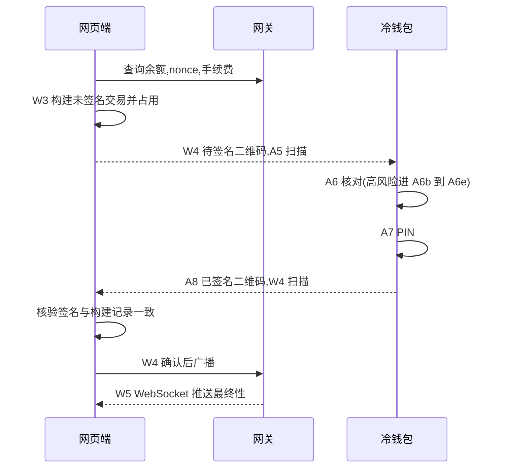

# 产品设计

页面编号:A 开头是冷钱包,W 开头是网页端.

## 1. 三方分工

|        | 冷钱包                      | 网页端(浏览器)                      | 网关                   |
| ------ | --------------------------- | ----------------------------------- | ---------------------- |
| 网络   | 离线,应用不申请联网权限     | 联网                                | 联网                   |
| 持有   | 助记词,私钥                 | 公钥,地址,交易记录,地址簿           | 无                     |
| 负责   | 解析,核对,签名,核对收款地址 | 派生 Bitcoin 地址,构建交易,核验签名 | 查询链上数据,广播,推送 |
| 做不到 | 查余额,广播                 | 签名                                | 签名,也不记得任何用户  |

两端用主密钥指纹(如 `73C5DA0A`)确认是同一个钱包.

## 2. 核心流程

### 流程一:配对

1. **A1** 冷钱包离线自检,创建钱包,或进入 **A1b** 导入助记词.
2. **A2** 备份助记词,**A2b** 验证.导入时跳过这两步.
3. **A2c** 设置 PIN.
4. **A3** 冷钱包首页,点"连接网页端".
5. **A4** 冷钱包展示观察钱包二维码.
6. **W0** 网页端首次打开,点"扫码连接".
7. **W2** 扫码,选择要导入的账户,数据写入浏览器.
8. **W7** 核对第一个收款地址,见流程三.
9. **W1** 资产总览.

一次扫码同时配好主网和测试网,配对时不选网络,切换网络时不用重新配对.

### 流程二:转账

### 流程三:收款

1. **W7** 显示收款地址,路径和收款二维码.收款二维码是纯地址,给付款方扫.
2. 点"冷钱包核对",W7 换成核对二维码,**A5** 冷钱包扫码.
3. **A9** 冷钱包从路径重新派生,显示"属于本钱包"或"不属于".
4. 用户对比两边的地址,在 W7 点"地址一致".

## 3. 页面清单

### 3.1 冷钱包

底部导航三项:钱包,收款,设置.所有页面都带系统状态栏和导航栏的安全区,见 [界面规范](06-ui.md#7-移动端适配).

| 页面               | 要点                                                                                                                                                                                     |
| ------------------ | ---------------------------------------------------------------------------------------------------------------------------------------------------------------------------------------- |
| A1 欢迎与自检      | 自检项与[安全设计 §2.2](04-security.md#22-离线环境自检)一致.说明专用手机前提.入口:创建,导入.自检未通过时不能创建,导入确认后可以继续                                                      |
| A1b 导入助记词     | 切换 12,15,18,21,24 词.内置键盘,按词校验,校验和错误时阻止.点已填的词可以回去改,其余的词不动.可选 BIP39 密码.本机还有密文时先提醒会覆盖                                                   |
| A2 备份助记词      | 切换 12 词和 24 词.可选 BIP39 密码.禁止截屏                                                                                                                                              |
| A2b 验证助记词     | 按序号选词.通过后才能继续,失败回到 A2                                                                                                                                                    |
| A2c 设置 PIN       | 输入两次.内置键盘                                                                                                                                                                        |
| A3 首页            | 指纹,离线标识.扫码,连接网页端两个入口.账户列表含 SegWit 和 Taproot,第二行显示缩短的地址,不显示派生路径.点账户进收款                                                                      |
| A4 导出观察钱包    | 动态二维码,可暂停,调速,全屏.包含的账户图标."只含公钥"                                                                                                                                    |
| A5 扫描            | 全屏取景,只有关闭按钮,取景框和一句提示.多帧时取景框下方显示帧进度.收齐后直接进入核对交易,核对地址或更新清单,没有中间的摘要                                                               |
| A6 核对转账        | 风险等级标签.金额.完整收款地址分段.字段按链不同,见[安全设计 §2.7](04-security.md#27-交易风险识别).原始数据可展开                                                                         |
| A6b 核对授权       | 红色风险横幅.被授权方完整地址.授权额度,无限额度单独标出.付款账户和交易类型.拒绝是主按钮,签名需要长按 3 秒                                                                                |
| A6c 无法识别的调用 | 黄色警告横幅.付款账户和交易类型.目标合约,方法选择器,附带金额,数据长度.原始数据默认展开.签名需要长按 3 秒                                                                                 |
| A6d 核对权限变更   | 红色风险横幅.当前控制方和新控制方.拒绝是主按钮,签名需要长按 3 秒                                                                                                                         |
| A6e Bitcoin 高风险 | 列出触发原因:多个收款方,手续费偏高,找零索引异常.全部输入和输出.签名需要长按 3 秒                                                                                                         |
| A7 PIN             | 交易摘要.6 位 PIN.每次都要确认手机屏幕锁或指纹.错误次数和递增延时,错多少次都不抹除.硬件暂时不可用时提示重试."忘记 PIN,用助记词恢复"入口一直都在                                          |
| A8 已签名          | 动态二维码,可暂停,调速,全屏.亮度自动调到最高.交易摘要                                                                                                                                    |
| A9 核对地址        | 完整地址分段,路径,是否属于本钱包                                                                                                                                                         |
| A11 收款           | 顶部用选择器选账户,显示收款二维码(纯地址),完整地址,网络.地址从本机公钥算出,不经过网页端.Bitcoin 的地址旁有"地址列表",打开 A11b                                                           |
| A11b 地址列表      | 全部发放过的地址.点一行回到 A11 显示那个地址,序号不变.使用新地址在这里,旧地址仍然能收款                                                                                                  |
| A10 设置           | 修改 PIN,先输新 PIN 再输当前 PIN,钱包只解开一次.查看助记词(要 PIN).内置清单.自动亮度开关,默认开,关闭后展示二维码时不调亮度,屏幕照样常亮.语言切换.应用版本和签名证书指纹.抹除钱包(要 PIN) |
| A12 内置清单       | 版本号,显示为 v1.0.0.按网络列出代币."更新清单"才打开扫码,扫到后显示新版本,输 PIN 后生效                                                                                                  |
| AS 异常态          | 自检失败,指纹不匹配,解析失败,禁止签名,摄像头被拒,需恢复,导入覆盖.自检失败时确认后继续这一次操作,生成新钱包要等自检通过或放弃新建                                                         |

### 3.2 网页端

网页端做两件事:看和发起.看是高频,只读,随时能走开,发起是低频,跨两台设备,要走完.所有内容归入三种层级:

| 层级   | 规则                                       | 成员                                         |
| ------ | ------------------------------------------ | -------------------------------------------- |
| 页面   | 名词,可以停留,占主导航                     | 资产,交易记录,地址簿,冷钱包,设置             |
| 子页面 | 一个具体对象,导航停在父级,有返回父级的链接 | 资产详情,转账,签名,交易详情,未上链的请求     |
| 浮层   | 一次性的轻任务,关掉回到原处                | 收款,连接冷钱包,导入备份,导出备份,编辑联系人 |

转账和收款是动作,不占导航.入口在资产,资产详情,地址簿和冷钱包里.

公共框架:标志右侧是网络标签,点一下切换主网和测试网.顶部导航四项(资产,交易记录,地址簿,冷钱包),右侧依次是待处理,连接状态和延迟,钱包切换.设置在钱包切换的菜单里.手机上四项导航放到底部标签栏.没有钱包时只有 W0,其他页面都看不到.

| 页面             | 要点                                                                                                                                                                                                                                                             |
| ---------------- | ---------------------------------------------------------------------------------------------------------------------------------------------------------------------------------------------------------------------------------------------------------------- |
| W0 首次打开      | 扫码连接冷钱包,或导入备份文件,都是浮层.语言切换                                                                                                                                                                                                                  |
| W1 资产          | 总资产,资产分布,转账和收款入口.待处理.持仓,最近记录,钱包状态.持仓按资产合并,按估值从高到低.点一行进 W11.转账和收款在行尾.零余额和未识别代币各收一组,展开后仍在持仓之后.零余额的展开状态存在本地                                                                  |
| W11 资产详情     | 这个资产的总额,估值,带着这个资产的转账和收款.分布:拆到网络和账户.这个资产的最近记录                                                                                                                                                                              |
| W2 连接冷钱包    | 浮层.摄像头扫码或上传图片,选择账户,钱包名称.保存后接着打开 W7 核对第一个地址                                                                                                                                                                                     |
| W3 发起转账      | 资产选择器列出全部币种和网络,付款账户随选中的资产变化.收款地址校验,金额,手续费(按链不同),高级设置.右侧摘要                                                                                                                                                       |
| W4 冷钱包签名    | 待签名动态二维码,可暂停,调速,全屏.扫回签名后自动核对.手续费报价倒计时.取消时说明签名是否仍有效.核验通过后确认广播,之后落到 W5.中途离开时请求留在待处理                                                                                                           |
| W5 交易详情      | 所有交易同一个模板.上过链的地址是 `/history/网络/哈希`,本地发起和链上同步的相同.金额,对方,状态,交易哈希和区块浏览器链接,完整地址,备注.这个浏览器发起的交易还有最终性进度(实时),时间线和加速,取消.转入和别处发出的交易现查确认数.没有"转给这个地址"和"存入地址簿" |
| W6 设置          | 语言切换.连接状态.本地数据和持久化状态.备份:导出和导入是两个浮层,导出的口令输两次.清除本地数据                                                                                                                                                                   |
| W7 收款          | 浮层.切换账户.地址,网络,是否已核对.未核对时主操作是冷钱包核对,核对过后主操作是复制.核对时换成给冷钱包扫的核对二维码,显示路径,"地址一致"只在这时出现.Bitcoin 可以使用新地址,旧地址仍然能收款,地址列表在浮层内切换.全部发放过的地址可以点回来显示,序号不变         |
| W8 交易记录      | 只放上过链或正在上链的交易.进行中的排在最前面,其余按天分组.按方向和网络筛选.已确认不显示标签,异常才显示.每一行进 W5.后台下载时标题右边显示下载中                                                                                                                 |
| W8b 未上链的请求 | 没上链就结束的请求,金额不带符号,不算资金流动.已放弃但签名有效的要警告.不再占序号的可以在 W5 删除,还占着序号或者刚被替换的不能删.从 W8 进入                                                                                                                       |
| W9 地址簿        | 联系人列表,待确认的联系人单独标出.添加和编辑是浮层                                                                                                                                                                                                               |
| W10 冷钱包       | 已配对的冷钱包,指纹,账户和核对状态.配对新钱包.更新内置清单                                                                                                                                                                                                       |
| WS 异常态        | 网关断开,摄像头被拒,核验失败,广播结果不明,链上失败                                                                                                                                                                                                               |

交易状态决定它出现在哪里,顶栏和首页的待处理用同一个口径:

| 状态                 | 出现在                      | 主操作         |
| -------------------- | --------------------------- | -------------- |
| 待签名               | 待处理                      | 继续签名       |
| 已签名               | 待处理                      | 广播           |
| 结果不明             | 待处理,交易记录的进行中     | 重试广播同一笔 |
| 已广播超时           | 待处理,交易记录的进行中     | 加速或取消     |
| 广播中,已广播,确认中 | 交易记录的进行中            | 查看进度       |
| 已确认               | 交易记录                    | 查看           |
| 链上失败             | 交易记录,没看过时也在待处理 | 重新发起       |
| 已替换,已过期,已放弃 | 未上链的请求                | 查看           |
| 已放弃但签名有效     | 未上链的请求,带警告         | 发替换交易     |

本地判定未上链,链上却查到的交易同时出现在交易记录和未上链的请求里,并标明本地记录已过时.

## 4. 交互约定

- **动态二维码**:展示端自动轮播,可暂停,调速,全屏.接收端不管帧的顺序,显示进度.尺寸规则见[界面规范 §4.5](06-ui.md#45-二维码).
- **地址**:列表里用短格式 `0x7a3F…9C21`.需要核对的地方显示完整地址,4 个字符一组.
- **风险确认**:普通交易点按确认.高风险和无法识别的交易长按 3 秒确认.之后都要输 PIN.
- **测试网**:功能和主网相同.网页端标志右侧的标签显示琥珀色.资产按同链同符号的主网资产计价,估值只用于展示.冷钱包不区分,只显示网络名.
- **实时**:余额,交易状态,最终性由 WebSocket 推送,不需要手动刷新.断线时显示状态并改用轮询.
- **钱包切换**:只有网页端有,用于切换配对的多个冷钱包.冷钱包只有一个种子.
