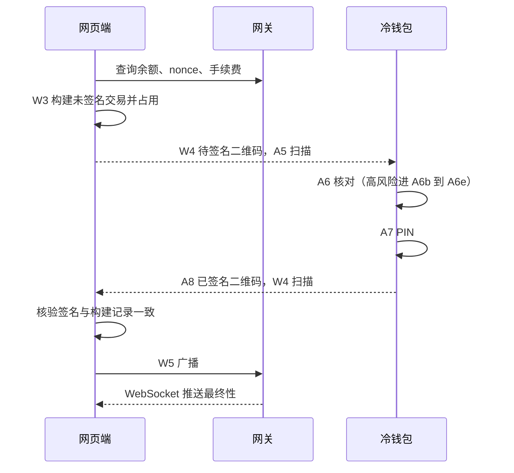

# 产品设计

页面编号：A 开头是冷钱包，W 开头是网页端。

## 1. 三方分工

|        | 冷钱包                         | 网页端（浏览器）                      | 网关                     |
| ------ | ------------------------------ | ------------------------------------- | ------------------------ |
| 网络   | 离线，应用不申请联网权限       | 联网                                  | 联网                     |
| 持有   | 助记词、私钥                   | 公钥、地址、交易记录、地址簿          | 无                       |
| 负责   | 解析、核对、签名、核对收款地址 | 派生 Bitcoin 地址、构建交易、核验签名 | 查询链上数据、广播、推送 |
| 做不到 | 查余额、广播                   | 签名                                  | 签名，也不记得任何用户   |

两端用主密钥指纹（如 `73C5DA0A`）确认是同一个钱包。

## 2. 核心流程

### 流程一：配对

1. **A1** 冷钱包离线自检，创建钱包，或进入 **A1b** 导入助记词。
2. **A2** 备份助记词，**A2b** 验证。导入时跳过这两步。
3. **A2c** 设置 PIN。
4. **A3** 冷钱包首页，点「连接网页端」。
5. **A4** 冷钱包展示观察钱包二维码。
6. **W0** 网页端首次打开，点「扫码连接」。
7. **W2** 扫码，选择要导入的账户，数据写入浏览器。
8. **W7** 核对第一个收款地址，见流程三。
9. **W1** 资产总览。

一次扫码同时配好主网和测试网，登录时不选网络，切换网络时不用重新配对。

### 流程二：转账

### 流程三：收款

1. **W7** 显示收款地址、路径和收款二维码。收款二维码是纯地址，给付款方扫。
2. 点「冷钱包核对」，W7 换成核对二维码，**A5** 冷钱包扫码。
3. **A9** 冷钱包从路径重新派生，显示「属于本钱包」或「不属于」。
4. 用户对比两边的地址，在 W7 标为已核对。

## 3. 页面清单

### 3.1 冷钱包

底部导航三项：钱包、收款、设置。所有页面都带系统状态栏和导航栏的安全区，见 [界面规范](06-ui.md#7-移动端适配)。

| 页面               | 要点                                                                                                                                                                                                                         |
| ------------------ | ---------------------------------------------------------------------------------------------------------------------------------------------------------------------------------------------------------------------------- |
| A1 欢迎与自检      | 自检项与[安全设计 §2.2](04-security.md#22-离线环境自检)一致。说明专用手机前提。入口：创建、导入                                                                                                                              |
| A1b 导入助记词     | 内置键盘，按词校验，校验和错误时阻止。可选 BIP39 密码                                                                                                                                                                        |
| A2 备份助记词      | 切换 12 词和 24 词。可选 BIP39 密码。禁止截屏                                                                                                                                                                                |
| A2b 验证助记词     | 按序号选词。通过后才能继续，失败回到 A2                                                                                                                                                                                      |
| A2c 设置 PIN       | 输入两次。内置键盘。说明错误 10 次抹除                                                                                                                                                                                       |
| A3 首页            | 指纹、离线标识。扫码、连接网页端两个入口。账户列表含 SegWit 和 Taproot，第二行显示缩短的地址，不显示派生路径。点账户进收款                                                                                                   |
| A4 导出观察钱包    | 动态二维码。包含的账户图标。「只含公钥」                                                                                                                                                                                     |
| A5 扫描            | 全屏取景，只有关闭按钮、取景框和一句提示。多帧时取景框下方显示帧进度。收齐后直接进入核对交易、核对地址或更新清单，没有中间的摘要                                                                                             |
| A6 核对转账        | 风险等级标签。金额。完整收款地址分段。字段按链不同，见[安全设计 §2.7](04-security.md#27-交易风险识别)。原始数据可展开                                                                                                        |
| A6b 核对授权       | 红色风险横幅。被授权方完整地址。授权额度，无限额度单独标出。付款账户和交易类型。拒绝是主按钮，签名需要长按 3 秒                                                                                                              |
| A6c 无法识别的调用 | 黄色警告横幅。付款账户和交易类型。目标合约、方法选择器、附带金额、数据长度。原始数据默认展开。签名需要长按 3 秒                                                                                                              |
| A6d 核对权限变更   | 红色风险横幅。当前控制方和新控制方。拒绝是主按钮，签名需要长按 3 秒                                                                                                                                                          |
| A6e Bitcoin 高风险 | 列出触发原因：异常 sighash、手续费偏高、找零索引异常。全部输入和输出。签名需要长按 3 秒                                                                                                                                      |
| A7 PIN             | 交易摘要。6 位 PIN。输错后下一次要先确认手机屏幕锁。错误次数和递增延时。错误 10 次抹除，指纹变更后只限时不抹除                                                                                                               |
| A8 已签名          | 动态二维码。亮度自动调到最高。交易摘要                                                                                                                                                                                       |
| A9 核对地址        | 完整地址分段、路径、是否属于本钱包                                                                                                                                                                                           |
| A11 收款           | 顶部用选择器选账户，显示收款二维码（纯地址）、完整地址、网络。地址从本机公钥算出，不经过网页端。Bitcoin 可以使用新地址，旧地址仍然能收款，右上角的历史图标打开 A11b                                                          |
| A11b 地址列表      | 全部发放过的地址。点一行回到 A11 显示那个地址，序号不变                                                                                                                                                                      |
| A10 设置           | 修改 PIN，先输新 PIN 再输当前 PIN，钱包只解开一次。查看助记词（要 PIN）。内置清单。自动亮度开关，默认开，关闭后展示二维码时不调亮度。语言切换。应用版本和签名证书指纹。抹除钱包（要 PIN，指纹变更后不显示，输对 PIN 后恢复） |
| A12 内置清单       | 版本号，显示为 v1.0.0。按网络列出代币。「更新清单」才打开扫码，扫到后显示新版本，输 PIN 后生效                                                                                                                               |
| AS 异常态          | 自检失败、指纹不匹配、解析失败、禁止签名、摄像头被拒、需恢复                                                                                                                                                                 |

### 3.2 网页端

公共框架：标志右侧是网络标签，点一下切换主网和测试网。顶部导航（资产、转账、交易记录、地址簿、冷钱包、设置），右侧依次是待处理提示、连接状态和延迟、钱包切换。手机上导航放到底部标签栏，冷钱包和设置在「更多」里。

| 页面          | 要点                                                                                                                                                                       |
| ------------- | -------------------------------------------------------------------------------------------------------------------------------------------------------------------------- |
| W0 首次打开   | 扫码连接冷钱包，或导入备份文件                                                                                                                                             |
| W1 资产       | 总资产。转账和收款入口。持仓列表，零余额默认收起，点一行进入转账。有待签名时才出现提示条                                                                                   |
| W2 连接冷钱包 | 摄像头扫码。选择账户。钱包名称                                                                                                                                             |
| W3 发起转账   | 资产选择器列出全部币种和网络，付款账户随选中的资产变化。收款地址校验、金额、手续费（按链不同）、高级设置。右侧摘要                                                         |
| W4 冷钱包签名 | 待签名动态二维码，可暂停、调速、全屏。扫回签名后自动核对。手续费报价倒计时。取消时说明签名是否仍有效                                                                       |
| W5 广播       | 交易哈希、最终性进度（实时）、时间线、交易详情。加速和取消                                                                                                                 |
| W6 设置       | 语言切换。网关和连接状态。本地数据和持久化状态。加密备份导出和导入。清除本地数据                                                                                           |
| W7 收款       | 地址、路径、是否已核对。默认显示收款二维码（纯地址），可切换到给冷钱包扫的核对二维码。切换账户。Bitcoin 可以使用新地址，旧地址仍然能收款，收款地址右上角的历史图标打开 W7b |
| W7b 地址列表  | 全部发放过的地址。点一行回到 W7 显示那个地址，序号不变                                                                                                                     |
| W8 交易记录   | 按网络和状态筛选，覆盖全部生命周期状态                                                                                                                                     |
| W9 地址簿     | 联系人列表，待确认的联系人单独标出                                                                                                                                         |
| W10 冷钱包    | 已配对的冷钱包、指纹、账户和核对状态。配对新钱包。更新内置清单                                                                                                             |
| WS 异常态     | 网关断开、摄像头被拒、核验失败、广播结果不明、链上失败                                                                                                                     |

## 4. 交互约定

- **动态二维码**：展示端自动轮播，可暂停、调速、全屏。接收端不管帧的顺序，显示进度。尺寸规则见[界面规范 §4.5](06-ui.md#45-二维码)。
- **地址**：列表里用短格式 `0x7a3F…9C21`。需要核对的地方显示完整地址，4 个字符一组。
- **风险确认**：普通交易点按确认。高风险和无法识别的交易长按 3 秒确认。之后都要输 PIN。
- **测试网**：功能和主网相同。网页端标志右侧的标签显示琥珀色。资产按同链同符号的主网资产计价，估值只用于展示。冷钱包不区分，只显示网络名。
- **实时**：余额、交易状态、最终性由 WebSocket 推送，不需要手动刷新。断线时显示状态并改用轮询。
- **钱包切换**：只有网页端有，用于切换配对的多个冷钱包。冷钱包只有一个种子。
