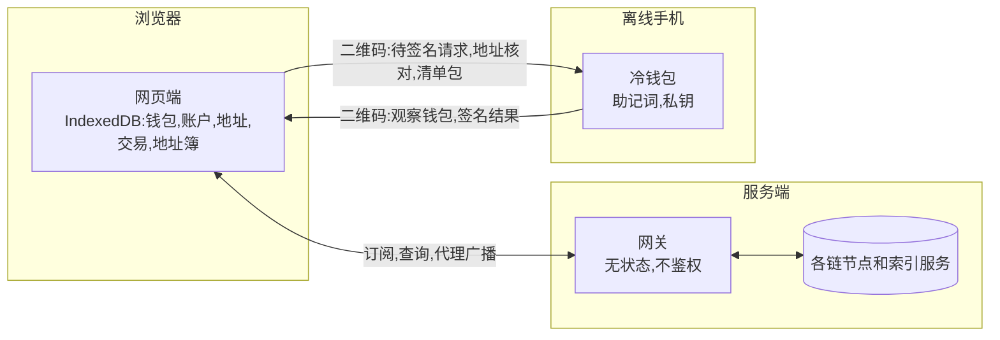
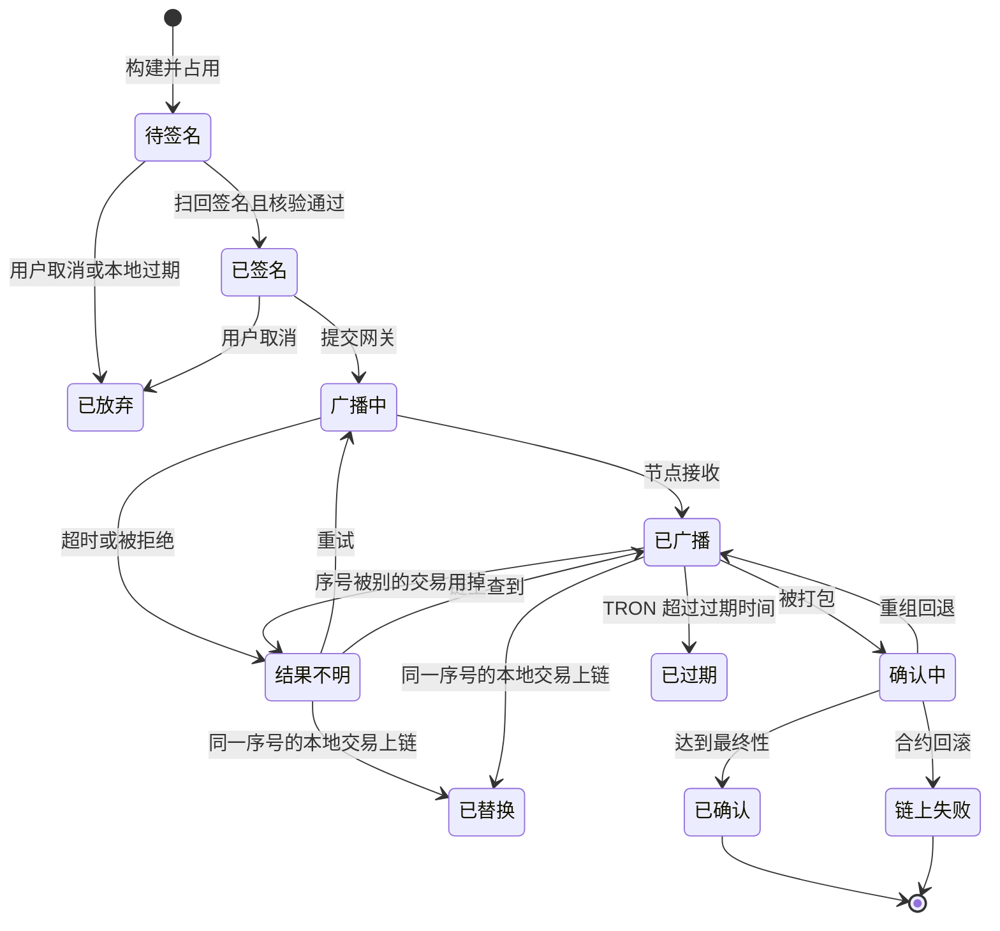

# 系统设计

> 本文只写与实现无关的设计,选型见[技术方案](08-tech-stack.md).

## 1. 架构

| 端         | 负责                                             | 不做                                       |
| ---------- | ------------------------------------------------ | ------------------------------------------ |
| 手机客户端 | 储存密钥.核对网页端发来的内容,签名后显示结果     | 不联网,不查询链上数据,不构建交易           |
| 网关       | 提供订阅(WebSocket),查询信息,代理广播            | 不构建交易,不保存用户数据,不接触私钥和公钥 |
| 网页端     | 提供全部交互,构建要签名的内容,保存观察钱包和交易 | 不持有私钥,不直接连节点                    |

一笔转账的交互:

1. 网页端向网关查询余额,手续费,nonce 这类构建所需的信息,在本地构建未签名交易.
2. 网页端用二维码把未签名交易交给手机客户端.
3. 手机客户端解析,显示核对内容,用户确认后签名,用二维码交回签名结果.
4. 网页端核验签名结果,交给网关代理广播.
5. 网页端通过 WebSocket 订阅地址和区块,跟踪到最终性.

## 2. 数据边界

| 方向           | 内容                                                                  |
| -------------- | --------------------------------------------------------------------- |
| 冷钱包到网页端 | Bitcoin 账户的扩展公钥,EVM,TRON,Solana 账户的公钥,派生路径,主密钥指纹 |
| 网页端到冷钱包 | 未签名交易,派生路径,主密钥指纹,网络标识,请求 ID                       |
| 冷钱包到网页端 | 签名结果,请求 ID                                                      |
| 网页端到网关   | 地址列表,已签名的原始交易.不发送扩展公钥                              |

永远不离开冷钱包的:助记词,BIP39 密码,私钥,PIN.

## 3. 浏览器存储

所有观察钱包状态都在浏览器的 IndexedDB 里.

| 表           | 内容                                                                              |
| ------------ | --------------------------------------------------------------------------------- |
| wallets      | 主密钥指纹,名称,网络,配对时间                                                     |
| accounts     | 所属钱包,链,网络,派生路径,扩展公钥或账户公钥                                      |
| addresses    | 所属账户,路径索引,是否找零,地址,是否已在冷钱包核对                                |
| txs          | 业务编号,网络,状态,未签名数据,签名数据,哈希,创建和过期时间,时间线                 |
| reservations | 待处理交易占用的 nonce,UTXO,找零索引                                              |
| notes        | 交易备注,键是交易标识                                                             |
| chainTxs     | 链上记录,来自同步,本地交易有结果时也写一条,格式和标识相同.随时能重新拉取,不进备份 |
| feedCursors  | 每批地址的水位,翻页游标,是否翻到最早                                              |
| balances     | 余额的本地缓存,带取到时的高度                                                     |
| contacts     | 名称,链,地址,是否待确认                                                           |
| settings     | 当前网络,当前钱包,收款地址序号                                                    |

- **交易标识**:`网络:哈希`,十六进制哈希转小写,Solana 的 Base58 保持原样.备注和链上记录都用它.`TX-20261030-0001` 只是本地编号,因为还没上链的交易没有哈希.
- **多钱包**:一个浏览器可以配对多个冷钱包,用主密钥指纹区分,导航栏切换.冷钱包自身只有一个种子.
- **持久化**:首次写入时调用 `navigator.storage.persist()`.被拒绝时不阻断使用,W6 的本地数据区显示"未持久化",提示导出备份.钱包和账户仍可以让冷钱包重新扫码恢复.
- **恢复**:清除数据后,钱包和账户可以让冷钱包重新扫码恢复.交易记录可以从链上重新拉取.地址簿和备注只能从备份恢复.
- **备份**:导出为口令加密的文件.WebCrypto AES-GCM,密钥由 PBKDF2-SHA256 派生,迭代 60 万次,随机盐和 IV,文件带格式版本.口令至少 12 个字符.不含网关地址.导入时与现有数据合并,联系人标为待确认,账户标为未核对.本地已有的钱包不接受备份新增或改动账户.
- **多标签页**:用 BroadcastChannel 同步变更.构建交易时用 Web Locks 按账户加锁,在锁内完成三件事:结合 reservations 分配 nonce,UTXO 和找零索引,写入占用,写入 txs.
- **释放占用**:到达最终状态后才释放,确认中的交易可能被重组退回.已签名的交易被放弃时不释放,签名仍然有效,要发替换交易,见第 9 节.
- **主网和测试网分开**:冷钱包一次导出全部账户,网页端按路径分成主网和测试网两个观察钱包,数据互不混用.

### 3.1 链上状态同步

网页端是一个有状态的小客户端.余额和交易记录都存在本地,界面只读本地,快照和推送都写入本地.网关不存状态,游标由浏览器保存.

- **顺序**:每批地址先订阅,收到确认后再取这批的快照.网关先取好基线和当时的高度才确认订阅,所以确认之后的变化一定会被推送.一批订阅回复通常同时到,合成一次快照.
- **合并**:余额带高度,不低于本地才覆盖,快照和推送谁先到都不会用旧值盖掉新值.交易记录按交易标识写入,重复收到没有影响.余额用网关给的绝对值,不用交易累加,手续费,合约内部转账和租金都不一定出现在解析结果里.
- **遗漏**:每条推送带 `previous`,接不上上一条就只补这批地址.推送里 `txs` 为空表示网关这次没取到交易,同样只补这批地址.断线重连后重新订阅,每批确认后取快照.
- **水位**:已经不可回滚的位置,单位由链决定,浏览器原样传回,不解析.EVM 是 finalized 区块,Bitcoin 是 6 个确认之前的高度,TRON 是最新已确认区块的时间,Solana 是 finalized slot.
- **批次**:一批地址共用一个水位和翻页游标,最多 100 个.已同步的批次不变,新地址另成一批,所以加地址不影响已有的记录.
- **第一次同步**:快照带最新一页和翻页游标,更早的记录用户翻到时再取.
- **增量**:快照带上水位,只取之后的变化.一次超过一页时翻完全部页面,再在一个事务里删掉这批地址未定论的记录,写入新结果,最后推进水位.被重组掉的交易在这一步消失,中途失败时什么都不改.
- **比特币**:高度没变时网关返回 `unchanged`,一个地址都不查.
- **地址发现**:Bitcoin 的地址只由这里生成,只有别的钱包用同一个种子时才会多出地址,所以配对时跑一次,之后一天最多一次.一批地址一次问完哪些用过,结束时一次写入.
- **触发时机**:连接正常且没有失败时,空闲页面不发 HTTP 请求.余额,交易和高度都靠推送,延迟来自 WebSocket 心跳.还有未定论的记录时,新块最多每 30 秒触发一次这批地址的增量.查询失败的网络单独重试,从 15 秒开始逐步拉长到 5 分钟.推送断开时每 15 秒同步一次.
- **没有索引服务的网络**:网关在 `/v1/version` 的 `noHistory` 里列出,只有订阅期间的交易和从本机发出的交易,未定论的记录逐笔查状态.BSC,Polygon 和它们的测试网要配 HyperSync 才有完整历史.

## 4. 网关

### 4.1 原则

- 不存储用户数据,不鉴权.
- 可以缓存公共链上数据(区块,手续费,价格),不缓存与地址相关的查询结果.
- 日志只记录聚合指标.带地址或交易哈希的查询都用 POST,正文不进日志.
- 单次请求的地址数量设上限,单连接的订阅数量设上限,单 IP 订阅的地址总数设上限.
- 对接多个上游节点,自动切换.
- Bitcoin 优先用 Electrum 协议,一个连接批量查询,网关不存区块数据.公共服务器和自建的 electrs,Fulcrum 是同一个协议,换上游只改配置.Esplora 做备用.
- 有订阅才跟块,闲时不访问上游.每个网络一个跟块任务,所有订阅共用,每轮最多查一次全部被订阅的地址.

### 4.1.1 跟块

客户端只订阅网关.每条链怎么知道有新块,哪些地址有动静都不一样,差异在网关的 `watch` 里解决,对外是同一种推送.只有高度变化时不查地址,地址有动静才查这些地址的余额和交易.成本仍然随订阅的地址数增长:EVM 每 3 秒查一次全部地址的原生币余额,TRON 每分钟对账一次全部地址,Bitcoin 和 Solana 的长连接每个地址都有订阅,轮询时每个新高度查一次全部地址.所以单 IP 订阅的地址总数有上限.

| 链      | 高度                | 发现动静                                                             | 看不到的                        |
| ------- | ------------------- | -------------------------------------------------------------------- | ------------------------------- |
| Bitcoin | `headers.subscribe` | `scripthash.subscribe`,服务器推送,包含内存池                         | 无                              |
| EVM     | `newHeads`          | 代币用 `logs` 订阅按地址过滤.原生币每 3 秒批量查一次余额             | 内部转入的原生币没有交易记录    |
| Solana  | `slotSubscribe`     | `accountSubscribe` 订阅账户和代币账户,`logsSubscribe` 取提到它的交易 | 无                              |
| TRON    | 每 6 秒轮询         | `getblockbylimitnext` 解析区块,`eth_getLogs` 按收款地址过滤          | 内部转入的 TRX 靠每分钟对账发现 |

原生币在 EVM 上没有日志,内部转账也不在区块的交易列表里,免费节点没有 trace,所以只能靠余额发现.TRON 节点没有订阅接口,只能按块轮询,但一轮的请求数和地址数无关.

长连接建立后对账一次,把订阅基线和长连接基线之间的变化找回来.断开时换下一个上游,全部不可用时改为轮询高度,每个新高度查一次全部地址.

一批地址查询失败时,只有用到这批地址的订阅等下一轮,其余订阅照常推送.连续 3 批失败就当上游故障,结束这一轮.EVM 的原生币批量查询全部失败才算这个上游不可用.

### 4.2 HTTP 接口

全局接口:

| 方法 | 路径           | 说明                    |
| ---- | -------------- | ----------------------- |
| GET  | `/v1/version`  | 网关版本,支持的网络标识 |
| GET  | `/v1/prices`   | 主网资产的美元价格      |
| POST | `/v1/snapshot` | 多个网络的最新状态      |

链上接口都以 `/v1/{network}` 开头,`network` 取值见第 5 节,如 `ethereum`,`sepolia`.

| 方法 | 路径                          | 说明                                                    |
| ---- | ----------------------------- | ------------------------------------------------------- |
| POST | `/v1/{network}/balances`      | 一批地址的原生币和代币余额                              |
| POST | `/v1/{network}/history`       | 一批地址的交易历史,分页.EVM 走 Etherscan 兼容的索引服务 |
| POST | `/v1/{network}/used`          | 一批地址里有过交易的(Bitcoin)                           |
| POST | `/v1/{network}/utxos`         | 一批地址的 UTXO(Bitcoin)                                |
| POST | `/v1/{network}/raw-txs`       | 一批 txid 的完整交易,用作前序交易(Bitcoin)              |
| POST | `/v1/{network}/nonce`         | 账户 nonce(EVM)                                         |
| POST | `/v1/{network}/resources`     | 带宽和能量(TRON)                                        |
| GET  | `/v1/{network}/ref-block`     | 引用区块(TRON)                                          |
| POST | `/v1/{network}/nonce-account` | nonce 账户的当前值(Solana)                              |
| GET  | `/v1/{network}/blockhash`     | 最近 blockhash,只用于创建 nonce 账户(Solana)            |
| GET  | `/v1/{network}/fees`          | 手续费,形式见第 10 节                                   |
| POST | `/v1/{network}/estimate`      | 估算费用(EVM,TRON,Solana)                               |
| POST | `/v1/{network}/broadcast`     | 广播已签名交易,幂等                                     |
| POST | `/v1/{network}/tx`            | 一批交易的状态和最终性                                  |

- Chain ID 和区块浏览器链接内置在网页端,网关不提供.
- 地址发现只用于 Bitcoin:浏览器本地派生一批地址,查询是否有记录,按 gap limit = 20 继续派生.

### 4.3 WebSocket

地址为 `/v1/ws`,消息格式为 JSON-RPC 2.0.

| 方法          | 参数                                         | 推送内容            |
| ------------- | -------------------------------------------- | ------------------- |
| `subscribe`   | `{channel: "blocks", network}`               | 新区块高度          |
| `subscribe`   | `{channel: "addresses", network, addresses}` | 余额变化,新交易     |
| `subscribe`   | `{channel: "tx", network, hash}`             | 最终性变化,最终状态 |
| `subscribe`   | `{channel: "prices"}`                        | 价格更新            |
| `unsubscribe` | 订阅 ID                                      |                     |

- 订阅只存在于当前连接的内存里,断开即失效.
- 单连接上限 5000 个地址和 100 笔交易,单 IP 的全部连接合计上限 20000 个地址.
- 30 秒一次心跳.
- 断线后按退避策略重连,重连后重新订阅,并用 HTTP 拉一次余额和未完成交易的状态,补上漏掉的推送.
- 断线期间,未完成的交易每 15 秒用 HTTP 轮询一次.

## 5. 网络与派生

| 链              | 网络     | 标识             | Chain ID | 账户路径                            |
| --------------- | -------- | ---------------- | -------- | ----------------------------------- |
| Bitcoin         | 主网     | `bitcoin`        |          | `m/84'/0'/0'`,Taproot `m/86'/0'/0'` |
|                 | Testnet4 | `btc-testnet4`   |          | `m/84'/1'/0'`,Taproot `m/86'/1'/0'` |
|                 | Signet   | `btc-signet`     |          | 同 Testnet4                         |
|                 | Testnet3 | `btc-testnet3`   |          | 同 Testnet4                         |
| Ethereum        | 主网     | `ethereum`       | 1        | `m/44'/60'/0'/0/0`                  |
|                 | Sepolia  | `sepolia`        | 11155111 | 同主网                              |
|                 | Hoodi    | `hoodi`          | 560048   | 同主网                              |
| BNB Smart Chain | 主网     | `bsc`            | 56       | 同 Ethereum                         |
|                 | 测试网   | `bsc-testnet`    | 97       | 同 Ethereum                         |
| Polygon         | 主网     | `polygon`        | 137      | 同 Ethereum                         |
|                 | Amoy     | `amoy`           | 80002    | 同 Ethereum                         |
| TRON            | 主网     | `tron`           |          | `m/44'/195'/0'/0/0`                 |
|                 | Nile     | `tron-nile`      |          | `m/44'/1'/0'/0/0`                   |
|                 | Shasta   | `tron-shasta`    |          | 同 Nile                             |
| Solana          | 主网     | `solana`         |          | `m/44'/501'/0'/0'`                  |
|                 | Devnet   | `solana-devnet`  |          | `m/44'/1'/0'/0'`                    |
|                 | Testnet  | `solana-testnet` |          | 同 Devnet                           |

- **账户模型**:每条链一个账户.Bitcoin 有 SegWit 和 Taproot 两个账户,接收和找零都用多地址.EVM,TRON,Solana 都是单地址.
- **导入旧钱包**:导入助记词时,额外导出 `m/44'/0'/0'` 和 `m/49'/0'/0'`.网页端发现余额时才显示,这两个账户只用于转出.
- **地址从哪来**:Bitcoin 由浏览器从扩展公钥派生.EVM,TRON,Solana 由冷钱包导出账户公钥,浏览器算出地址.Solana 只能硬化派生,无法从上级公钥推出子公钥.
- **测试网隔离**:Bitcoin,TRON,Solana 的测试网用 coin type `1'`,私钥与主网不同.EVM 测试网与主网私钥相同,靠签名内的 Chain ID 隔离.
- **派生路径**:冷钱包导出上表的账户,加上导入钱包的两条旧路径.TRON 只接受这些路径.Bitcoin,EVM,Solana 不设白名单,其余路径告警,见[安全设计 §2.6](04-security.md#26-派生路径校验).

## 6. 二维码协议

传输层用 BC-UR 动态二维码:数据先做 CBOR 编码,再用喷泉码分帧循环播放,接收端不管帧的顺序,收够就能解码.

载荷层用 BitOne 自定义的 UR 类型.原因是标准类型放不下需要的字段:`psbt` 只是字节串,没有请求 ID,指纹和网络.两端都是 BitOne 自己的,不需要与第三方钱包互通.

| UR 类型           | 方向           | 字段                                                |
| ----------------- | -------------- | --------------------------------------------------- |
| `bitone-accounts` | 冷钱包到网页端 | 版本,主密钥指纹,账户列表(链,路径,公钥)              |
| `bitone-request`  | 网页端到冷钱包 | 版本,请求 ID,主密钥指纹,网络标识,路径列表,类型,载荷 |
| `bitone-response` | 冷钱包到网页端 | 版本,请求 ID,签名结果                               |
| `bitone-address`  | 网页端到冷钱包 | 版本,主密钥指纹,网络标识,路径,地址                  |
| `bitone-manifest` | 网页端到冷钱包 | 版本,清单数据,厂商签名                              |

`bitone-request` 的载荷按链不同:

| 链      | 载荷                                       |
| ------- | ------------------------------------------ |
| Bitcoin | PSBT 字节                                  |
| EVM     | 未签名交易的编码,EIP-712 数据,消息或裸哈希 |
| TRON    | `raw_data` 字节                            |
| Solana  | 消息字节                                   |

W7 给付款方扫的收款二维码不走这套协议,内容就是纯地址.

冷钱包的处理顺序:校验大小,核对指纹,校验路径和网络,解析载荷,分类,展示.

**解析上限**:整包不超过 256 KiB,帧数不超过 2000,CBOR 嵌套不超过 8 层,解码前就拒绝超限数据.带前序交易的 PSBT 可能接近上限,超限时网页端提示减少输入数量.

**字段校验**:账户,请求,响应和地址核对消息的顶层 map 必须是定长编码,重复键和尾部字节都拒绝.未知键被忽略,旧手机才读得懂新网页端的请求.

**协议冻结**:手机可能多年不更新,所以 `version` 永远是 1,规则见[交易解码标准 §1.2](10-tx-decoding.md#12-二维码协议冻结).以后只增加可选字段,已有字段的编号,类型和含义不变,必填字段不删除.

- 读到更高的 `version` 不按版本拒绝,已知字段齐全就照常解码.`bitone-request` 走核对页,多一条告警,普通转账也要长按.
- 必填字段缺失,或者 `version` 为 0 时拒绝.
- `bitone-request` 的键 8 是可选的链编号,和账户的链编号相同,现在只随请求携带.用整数读取,不认识的编号也能读完请求.

## 7. 交易生命周期

交易状态保存在浏览器里.

- **已过期的额外来源**:TRON 的已签名和结果不明,以及 Solana 创建 nonce 这一笔,都可能直接到已过期.
- **已替换的依据**:这个浏览器发出的,共用同一序号的交易上链才算已替换.网关报告序号被用掉时可能是谎报,这笔进入结果不明,继续占用序号,直到查到结果.
- **重组后的已替换**:已替换的交易可以回到确认中,界面如实显示,避免用户重复支付.
- **链上失败**:到最终阶段才进入终态.这之前显示执行失败,不释放占用.
- **结果不明**:网关可能谎报,所以"被拒绝"也算结果不明,只有链上数据才算定论.此时重试广播同一笔,需要重建时必须复用同一 nonce 或同一组 UTXO,保证最多一笔上链.
- **链上失败**:EVM 回执 `status` 为 0,TRON 结果不是成功,Solana 回执带错误.手续费已扣除,界面不能显示成成功.
- **已广播超时**:Bitcoin 超过 24 小时,EVM 超过 30 分钟,提示加速或取消.
- **加速**:Bitcoin 用 RBF,EVM 用同 nonce 提高手续费.两者生成新的待签名请求,要回到冷钱包签名.TRON 和 Solana 不提供加速.
- **取消**:Bitcoin 用同一组输入全部转回找零,EVM 用同 nonce 转 0 给自己,Solana 只推进 nonce,都要回到冷钱包签名.TRON 只能等过期.
- **网页端拦截**:同样的转账结果不明,或者已替换但没有本地的替换交易时,不让再发一笔.放弃的已签名交易挡住 nonce 时,要先发替换交易.
- **重组**:确认中的交易可以回退到已广播.已确认以最终性为准,不再回退.

## 8. 广播前核验

网页端扫回签名后,先还原完整交易,再逐项比对.任何一项不一致都拒绝广播.

| 链      | 核验项                                                            |
| ------- | ----------------------------------------------------------------- |
| 通用    | 请求 ID 一致.用付款账户的公钥验证签名                             |
| Bitcoin | 输入,输出,找零路径与构建记录一致                                  |
| EVM     | 收款地址,金额,数据,nonce,Gas Limit,手续费上限,Chain ID 一致       |
| TRON    | `raw_data` 字节与构建记录完全一致,含合约类型,过期时间,`fee_limit` |
| Solana  | 消息字节与构建记录完全一致,含全部指令和 nonce 账户                |

防重放:EVM 靠 nonce,Bitcoin 靠 UTXO,TRON 靠过期时间和交易哈希去重,Solana 靠 nonce 值推进.

## 9. 有效期与最终性

冷钱包没有可信时钟,所以有效期由交易本身决定.网页端的 30 分钟只是手续费报价的有效期.

| 链              | 签名的有效期                         | 怎么作废               | 完成标准             |
| --------------- | ------------------------------------ | ---------------------- | -------------------- |
| Bitcoin         | 不过期                               | 用同一组输入的替换交易 | 6 个确认             |
| Ethereum        | 不过期                               | 同 nonce 的替换交易    | `finalized` 区块     |
| BNB Smart Chain | 不过期                               | 同 nonce 的替换交易    | `finalized` 区块     |
| Polygon         | 不过期                               | 同 nonce 的替换交易    | `finalized` 区块     |
| TRON            | 构建时设为 30 分钟(协议上限 24 小时) | 无法主动作废,等过期    | 区块确认             |
| Solana          | 不过期,直到 nonce 推进               | 推进 nonce             | `finalized` 提交等级 |

- **TRON**:默认过期时间只有 60 秒,二维码往返来不及,所以构建时显式设置.引用区块取最新的已确认区块.
- **Solana**:blockhash 约 150 个 slot 后过期,也就是 1 分钟出头,所以转账用 durable nonce.
- **Solana nonce 账户**:每个账户一个,地址由付款账户和固定种子派生,冷钱包据此确认它是自己的 nonce 账户.首次 Solana 转账前要先创建,需要少量可赎回的 SOL.这一笔只能用 blockhash,有约 1 分钟的窗口,超时要重新构建.冷钱包要识别 AdvanceNonceAccount 必须是第一条指令.
- **创建分三步**:转入租金,分配空间,初始化.派生地址是公开的,用 CreateAccountWithSeed 的话,任何人往地址里存一点钱就能让创建永久失败.分配要付款账户签名,攻击者只能存钱,抢不走地址.
- **取消的含义**:取消只影响本地记录.已签名的交易仍然有效,界面要如实说明.W4 取消时,如果已经在冷钱包签名,要提示发替换交易才算作废.
- **进度展示**:W5 按上表的标准显示.Bitcoin 显示确认数,其余链显示阶段.

## 10. 手续费

| 链      | 形式                                   | 网页端要算的                                        |
| ------- | -------------------------------------- | --------------------------------------------------- |
| Bitcoin | sat/vB,慢,中,快三档                    | 按输入和输出估算大小                                |
| EVM     | 最高单价和优先费,慢,中,快三档          | Gas Limit 估算                                      |
| TRON    | 没有档位,消耗带宽和能量,不足时燃烧 TRX | 能量和带宽的消耗,`fee_limit`,收款方未激活时的激活费 |
| Solana  | 基础费加优先费                         | 收款方没有代币账户时的创建租金                      |
